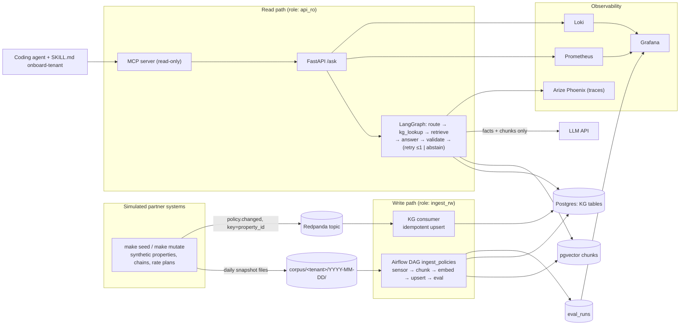

# PolicyGround — handover plan

Nothing here is built yet. This is the plan to build from. Record every decision below
in `DECISIONS.md` *at the moment you make it* — that record is itself part of what this
project demonstrates.

---

## 1. Pitch

**PolicyGround** answers questions about partner/property policies for customer-support
agents in a travel & hospitality context — cancellation windows, rate-plan exceptions,
chain-level overrides. It checks a knowledge graph first, cites everything, and watches
for drift between the graph and its own retrieval index. When it can't confirm an answer,
it refuses instead of guessing.

## 2. What this project is designed to demonstrate

Most RAG demos stop at "retrieve, then generate." This one is built around how plain
RAG over policy text actually fails, measured rather than assumed. The original
hypothesis was confident hallucination: chunk boundaries separating a rule from its
exception. The M1 baseline showed something different (INCIDENTS #1, D20). Over many
near-identical entities, similarity search often never retrieves the right property, and
a careful model then **abstains**. That's safe, but useless to a support agent (24%
false abstention at baseline). The second failure is that a vector index lags behind
real-time changes to the source of truth.

PolicyGround treats a knowledge graph as the ground truth. It resolves the entity and its
policy deterministically first, and uses RAG only for explanation and citation. The
headline is turning safe-but-useless abstentions into correct, cited answers. A
deterministic validator is the guardrail: it rejects any date or amount the graph
doesn't back up, and flags correct values resting on the wrong citation (D19). Its catch
rate is measured, not presumed.

The build deliberately spans the full stack a production GenAI system needs around the
model call itself: an agent framework (LangGraph) with a validate/retry/abstain path, a
scheduled data pipeline (Airflow) with retries and backfill, an event stream (Kafka) that
creates a real staleness window to detect, a full observability stack
(Prometheus/Grafana/Loki/Arize), and an eval gate that distinguishes real drift from
measurement noise. It's built multi-tenant from day one — a new business area onboards
through a written agent skill, not a one-off integration — because the point is a
reusable capability, not a single demo query.

**Known, stated limits of what this demonstrates:** this runs at prototype scale on a
synthetic corpus, on a single machine. It does not demonstrate operating this kind of
system at large multi-tenant production scale, nor deep Kubernetes cluster-level design —
say so plainly wherever this comes up (§8), rather than letting the demo imply otherwise.

## 3. Decisions to make before milestone 1

Log each as you decide it, with the alternative and why, in `DECISIONS.md`.

| # | Decision | Options | Recommendation |
|---|---|---|---|
| D1 | **Domain / first tenant** | (a) Partner-policy Q&A for CS agents in travel/hospitality. (b) A back-office policy bot (travel & expense, HR). (c) A public regulatory corpus. | (a). A wrong answer about a cancellation deadline has an obvious, concrete cost, so the hallucination story carries its own stakes without needing to be explained. |
| D2 | **Corpus** | (a) Synthetic, generated from the KG. (b) Real public documents. | (a). The KG is ground truth, so golden eval answers come for free and drift can be injected on purpose. Also avoids any appearance of using real third-party or partner data. |
| D3 | **KG store** | (a) Postgres with recursive CTEs. (b) Neo4j. | (a). One database to run, and a `WITH RECURSIVE` query resolving chain → brand → property policy inheritance is itself a useful SQL-depth signal. Neo4j reads as "graph" more loudly but adds a service and a query language for no measured benefit here. |
| D4 | **Agent framework** | (a) LangGraph. (b) LangChain only. (c) A hand-rolled loop on a raw SDK. | (a) — a graph with an explicit validate/retry/abstain path is a stronger fit here than a plain loop, and demonstrates comfort with a widely-used orchestration framework specifically. |
| D5 | **Airflow version** | (a) 3.x — current; Deadline Alerts replace SLAs. (b) 2.10.x — has `sla` literally, but check its support window before committing. | (a), while being able to explain what happened to SLAs in 3.x. |
| D6 | **The "breadth" slot (~2h)** | (a) Kafka/Redpanda. (b) A Snowflake trial. (c) AWS Lambda + S3 free tier. | (a) — it produces the project's best failure surface (the staleness race, below) for the time spent. |

## 4. Architecture

**Trust boundaries:** only the Kafka consumer and the Airflow DAG write to the KG; the API
connects as `api_ro`. The LLM sees only the facts and chunks it's handed, and its output
stays untrusted until the deterministic validator passes it. The API key lives only in
the API process. The MCP server is read-only.

**Designed failure surfaces (on purpose):**
1. Staleness race — the KG updates in seconds from Kafka; vectors update only nightly.
   They disagree in between, and that gap is the point.
2. Chunk boundaries split a rule from its exception.
3. Eval noise vs. real drift — need a measured noise band before calling anything "drift."
4. Rate limits (429s) on embeddings during a backfill.
5. A validator retry loop that blows up cost if left uncapped.

## 5. Build plan (16h budget: 15 planned + 1 buffer)

| Milestone | Hours | Running total |
|---|---|---|
| M1 Vertical slice | 3.0 | 3.0 |
| M2 KG grounding + chunking experiment | 3.0 | 6.0 |
| M3 Airflow DAG | 3.0 | 9.0 |
| M4 Kafka + drift | 2.0 | 11.0 |
| M5 Observability | 2.5 | 13.5 |
| M6 MCP + Skills + second tenant | 1.5 | 15.0 |
| Buffer | 1.0 | 16.0 |

### M1 — Vertical slice (3h)
**Goal:** `curl localhost:8000/ask` returns a cited answer; `make eval` prints a
correctness score.
**Done when:** `make up && make seed && make ingest && make eval` prints correctness over
30 golden questions; `DECISIONS.md`, `INCIDENTS.md`, `METRICS.md` all exist with at least
one real entry.

Steps: `docker-compose.yml` with `pgvector/pgvector:pg17`; a seeded-RNG generator for 5
chains / 150 properties / rate plans (some non-refundable) / cancellation windows /
chain-level overrides, rendering one Markdown doc per property with varied wording; a
naive fixed-size chunker (800 chars) embedded with a small local model, upserted to
`chunks`; a two-node LangGraph (`retrieve → answer`) that must cite chunk IDs; a
`POST /ask {tenant, question}` FastAPI endpoint; a golden-set generator deriving 30 Q/A
pairs from the KG itself (20 plain, 5 "exception" questions like non-refundable rates or
chain overrides, 5 unanswerable — correct behavior is to abstain); an eval runner scoring
exact-match on normalized dates/amounts plus abstention correctness, appending to
`METRICS.md`.

**Trap, deliberately not fixed yet:** the naive chunker splits "free cancellation until
48h before check-in" from "except non-refundable rates" — the exception questions fail
confidently. Log it as `INCIDENTS.md` #1 and leave it broken until M2; that before/after
is the story.

**Fallback:** skip LangGraph for a plain function; keep the demo, close the framework
requirement in M2 instead.

### M2 — KG grounding, validator, chunking experiment (3h)
**Goal:** exception questions pass; hallucinated numbers get blocked.
**Done when:** correctness ≥0.8, abstention accuracy ≥0.8 on unanswerable questions;
`METRICS.md` has a chunker × embedder comparison table (hit@5).

Steps: KG tables (`chain`, `property`, `rate_plan`, `policy_fact`); a
`resolve_policy(property_id)` recursive CTE resolving chain → property inheritance with
property overrides winning; graph nodes `route → kg_lookup → validate
→ (regenerate ≤1 | abstain)`, where `validate` requires every date/amount in the answer to
match a KG fact or a cited chunk; a structural chunker (one chunk per policy section,
exceptions kept with their rule) compared against the naive chunker, across two embedding
models; cost-per-question logged from token usage.

**Trap:** an uncapped regenerate-on-validator-failure loop can jump cost per question
5–10x. Record the before/after as an incident; cap at one retry.

**Fallback:** run the chunker comparison with one embedder instead of two.

### M3 — Airflow DAG (3h)
**Goal:** nightly ingestion with a sensor, retries, a deadline, and a clean backfill.
**Done when:** backfilling 5 dated snapshots produces exactly one chunk set per
(property, snapshot); the eval task writes to `eval_runs`; a forced 429 shows retries in
the logs.

Steps: install Airflow pinned to its own constraints file in a separate venv; a DAG with a
file sensor, tasks `chunk → embed → upsert → eval`, exponential-backoff retries, a
Postgres connection, and a Deadline Alert (or `sla` if you chose Airflow 2.x); idempotent
upserts keyed on `(tenant, property_id, snapshot_date, chunk_hash)`; a backfill over 5
generated snapshot days; a `FAIL_RATE` env var to simulate a 429 on the embed task.

**Trap:** a non-idempotent upsert makes backfill *duplicate* chunks, which inflates hit@5
while the system actually gets worse — the metric lies to you. Record it as an incident.

**Fallback:** skip the sensor and deadline; keep retries and backfill (these carry most
of the signal).

### M4 — Kafka + drift (2h)
**Goal:** show the staleness window, detect it, and show KG-first grounding survives it.
**Done when:** `make mutate` changes 10% of policies; before the nightly DAG runs, a
drift report shows a nonzero KG/vector disagreement rate and an eval drop beyond a
measured noise band; fact-question answers stay correct throughout.

Steps: add Redpanda to the compose file; `make mutate` publishes `policy.changed` events
keyed by `property_id`; a consumer does an idempotent KG upsert, committing offset after
write; a drift script runs the eval 3x on an unchanged corpus to establish a noise band
(mean ± 2σ) before flagging anything as drift, and computes a KG/vector disagreement rate.

**Trap:** re-delivered or unkeyed events apply out of order, so an old policy can
overwrite a newer one. Per-property keying gives ordering within a partition; a
`valid_from` guard makes writes idempotent regardless.

**Fallback:** skip Kafka, write mutations straight to the KG — keeps the drift story,
loses the event-streaming piece specifically.

### M5 — Observability (2.5h)
**Goal:** diagnose an M4 incident from a dashboard alone.
**Done when:** a provisioned Grafana dashboard shows request p95, tokens/cost per
question, validator rejection and abstain rates, the latest eval score with its noise
band, logs linked by request ID, and traces of the LangGraph run.

Steps: a `/metrics` endpoint; JSON logs shipped into Loki; tracing via
`openinference-instrumentation-langchain` into Phoenix; provisioned Grafana dashboards;
an alert rule for abstain rate exceeding 2x baseline.

**Trap:** using a high-cardinality field (like `property_id`) as a Prometheus label
causes a cardinality explosion. Keep labels to `tenant`/`route`; put IDs in logs and
traces only.

**Fallback:** Prometheus + Grafana + Phoenix only, drop Loki.

### M6 — MCP, Skills, second tenant (1.5h)
**Goal:** an agent onboards a new business area using a written skill.
**Done when:** following a `SKILL.md`, an agent (e.g. a coding-agent CLI) creates a second
tenant (spec, seed adapter, 10 golden questions); `make eval TENANT=<second>` passes;
`METRICS.md` records how many attempts it took.

Steps: a read-only MCP server (`ask_policy`, `get_property_policy`); connect an
off-the-shelf MCP server (e.g. a Postgres or Grafana one) from the same client; a
`SKILL.md` with inputs, steps, and a mandatory done-check so the agent can't declare
success early; an `AGENTS.md` describing the repo for coding agents.

**Trap:** printing to stdout corrupts a stdio MCP transport — logs must go to stderr.

**Fallback:** ship the skill and MCP server; skip the second tenant.

**Before publishing anything:** wiring the eval gate into CI, or pushing this repo
anywhere, is a separate decision from building it. Don't do either without deciding to.

## 6. Non-goals

No Kubernetes (a single-Deployment kind cluster doesn't demonstrate cluster-level depth —
it would invite probing the project can't survive; handle this in talking points instead,
§8). No cloud deployment of the full stack, no Terraform. No frontend. No Vault (an
optional stretch only if the buffer survives). No Mimir (Prometheus is enough; Mimir is
Prometheus-compatible long-term storage — know that, don't build it). No LLM-as-judge in
the eval gate — deterministic scoring on dates/amounts; a judge brings its own drift. No
fine-tuning, no multiple LLM providers, no real third-party data, ever.

## 7. Instrumentation — never backfilled

- **`DECISIONS.md`** — `## D# title / Context / Options / Chosen / Why / Revisit if`,
  seeded with D1–D6 as you actually decide them.
- **`INCIDENTS.md`** — `Symptom / Hypothesis / Actual cause / Fix / Prevention at scale /
  Time lost`. Expect: chunk boundary (M1), retry cost blowup (M2), backfill duplicates
  inflating hit@5 (M3), out-of-order events (M4), label cardinality (M5).
- **`METRICS.md`** — define every column before you have numbers, keep the bad early
  rows: correctness, abstention accuracy, hallucinated-number rate, hit@5 per
  chunker×embedder, fallback rate, cost/latency per question, eval noise band, staleness
  window (minutes), KG/vector disagreement rate, DAG retry count, skill attempts to pass
  the second tenant's eval.

## 8. What this project honestly doesn't demonstrate

Two things no prototype of this size can show, so they're worth naming up front rather
than letting the demo imply otherwise:
- **Operating at large-scale production volume.** This runs on a synthetic corpus at
  prototype scale, on a single machine. It demonstrates the disciplines (idempotency,
  retries, backfill, observability) that scale requires, not scale itself.
- **Kubernetes at cluster-design depth.** The project doesn't deploy to Kubernetes at
  all. If asked to reason about it live: autoscale on concurrency rather than CPU (LLM
  calls are I/O-bound), readiness probes, PodDisruptionBudgets, draining long-lived
  streams on rollout — these are worth having thought through even though nothing here
  builds them.

Anything else named as a non-goal in §6 (Terraform, Vault/Okta, a managed warehouse) is a
genuine gap, not a hidden one — bridge from the adjacent thing actually built here (SQL
depth, CI pipelines, least-privilege role separation) rather than overclaiming.

## 9. What this project is useful evidence for

This is deliberately built to be legible outside any single context: the failure modes
(chunk-boundary loss, index staleness, eval noise vs. real drift, retry cost blowup,
out-of-order events, label cardinality) are generic to any GenAI system layered on top of
a changing, nested-exception knowledge source — not specific to travel/hospitality or any
one company. The domain (partner/property policy for support agents) is a believable,
concrete stand-in; swapping in a different nested-policy domain (insurance coverage rules,
lending eligibility, HR benefits) would change almost nothing about the architecture.

**What it's evidence of, concretely:** hallucination management via a deterministic
validator rather than an LLM-as-judge; the judgment to measure before choosing an
architecture (chunking/embedding comparison, a measured noise band before calling
something "drift"); comfort with the full stack around a model call — orchestration
framework, scheduled data pipeline, event streaming, observability — not just the model
call itself; and treating a prototype's own failures (every `INCIDENTS.md` entry) as the
real deliverable, not something to hide.

**Talking points worth having ready, regardless of audience:**
- How do you manage hallucinations, and what does KG grounding buy over plain RAG?
- How do you evaluate an agent and notice it drifting in production, as distinct from
  normal run-to-run noise?
- How did you choose a chunking/embedding strategy, and how did you measure it rather
  than assume it?
- Why an orchestration framework and not a hand-rolled loop — and how do you bound it
  (turn limits, retry caps, cost per run)?
- Design a data pipeline with retries, a deadline, and a backfill — what breaks on
  backfill specifically, and how did you find out?

Present the staleness race and the drift detector as exactly what they are — findings from
a prototype — rather than as production experience.
