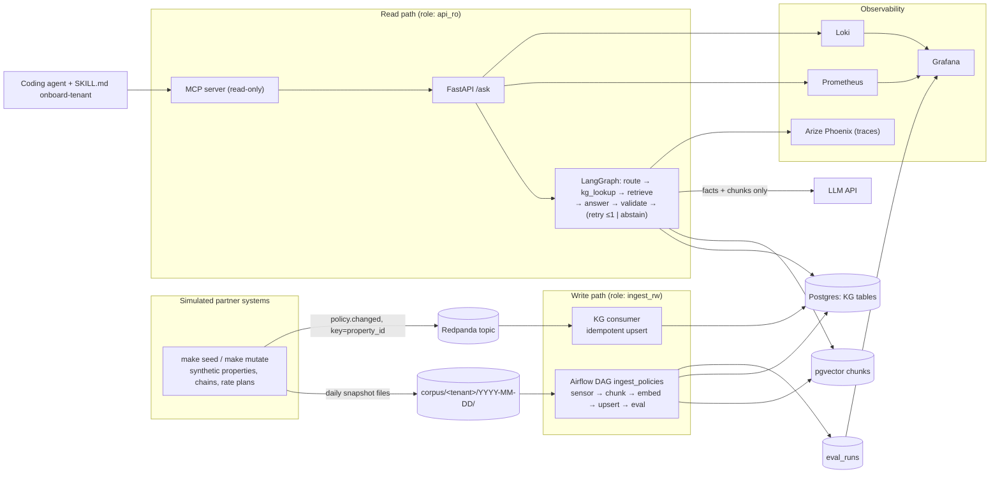

# PolicyGround

Policy Q&A for customer-support agents. A question like *"Can this guest still cancel the
Saver rate for free?"* is resolved against a knowledge graph first: the property, its
brand and chain, and the policy they inherit. Retrieval over policy documents is used only
to cite the answer. A deterministic validator then checks every date and amount against
the graph. If the system can't confirm an answer, it abstains instead of guessing.

The system runs on one machine with synthetic data. Two business areas ("tenants") run on
the same core: hotel cancellation and property policies, and travel-insurance coverage.

## Architecture



**Answer path.** `route` resolves the subject (a property, or an insurance product) by
fuzzy name matching against the graph. If the name is ambiguous or unknown, the system
abstains with the closest candidates. `kg_lookup` resolves the effective policy with a
recursive CTE: chain → brand → property → rate plan, with the most specific level
winning. `retrieve` searches only that subject's lineage documents. `answer` calls the
model with the resolved facts and the retrieved excerpts, and requires citations.
`validate` rejects any date, time or amount the facts or the cited excerpts don't back.
A rejected answer gets one regeneration; after that the system abstains. The retry cap
and LangGraph's recursion limit together bound cost per question.

**Two ways the data reaches the system.** Policy changes arrive as `policy.changed`
events on a Redpanda (Kafka-compatible) topic, keyed by subject. A consumer applies them
to the graph within seconds; a version guard means re-delivered or reordered events can't
overwrite newer facts. Documents are re-chunked and re-embedded by a nightly Airflow DAG
with a file sensor, retrying tasks, a deadline alert and idempotent upserts. Between the
two, the graph and the vector index disagree. That window is measured, not hidden.

**Trust boundaries.** Only the consumer and the DAG write, as `ingest_rw`. The API reads
as `api_ro`; Grafana and the off-the-shelf Postgres MCP server read as `grafana_ro`. The
model sees only the facts and excerpts it's handed, and its output is untrusted until the
validator passes it. The Anthropic API key is read only by the API process.

**Tenants are data plus a small adapter.** Each tenant is a `spec.yaml` (entity levels,
fact types, prompt nouns, scorer rules) and an `adapter.py` (generate the world, render
documents, derive a golden set). The core is generic. New tenants are onboarded by a
coding agent following [`.claude/skills/onboard-tenant/SKILL.md`](.claude/skills/onboard-tenant/SKILL.md),
which ends in a mandatory done-check (`make check-tenant`) the agent can't skip.

## What was measured

All numbers are from [METRICS.md](METRICS.md). Rows there are appended by the tools and
never edited, including the bad early ones.

**Plain RAG vs. graph-first** (hotels, 30 headline questions, Claude Haiku 5.5):

| | correct | false abstention | abstention accuracy | hard questions | $/question |
|---|---|---|---|---|---|
| Plain RAG (naive chunks, bge-small) | 0.76 | 0.24 | 1.00 | 2/8 | 0.00034 |
| Graph-first (structural chunks, e5-base) | 1.00 | 0.00 | 1.00 | 8/8 | 0.00034 |

The expected failure was confident hallucination. What the baseline actually showed was
**over-abstention**: among 150 near-identical properties, similarity search often never
retrieved the right one, and the model correctly refused. That's safe, but useless to a
support agent. Resolving the subject in the graph first turns those refusals into
correct, cited answers ([INCIDENTS #1](INCIDENTS.md), [D20](DECISIONS.md)).

**Validator.** Faults injected into correct answers (date +1 day, time +1 hour, window
+24 h, amount +5, citations removed or invented) are caught at 0.99–1.00, with zero false
positives on the unmodified answers. One of the misses led to a claim-level fix
([INCIDENTS #3](INCIDENTS.md)).

**Drift vs. noise.** The eval runs three times on an unchanged corpus to get a noise band
(mean ± 2σ, floored at sampling error, [D37](DECISIONS.md)) before anything counts as
drift. In the second drift run, 10% of policies were changed through the event stream.
While the index was stale, plain RAG fell from 0.76 to 0.00 (36 of 45 answers stated the
old value), while graph-first stayed at 1.00, within its band. The graph/index
disagreement rate was 0.10, and the staleness window closed in 5–8 minutes once the DAG
ran.

**Pipeline.** Re-running a backfill with a plain `INSERT` doubled every chunk, and the
retrieval metric went *down* (0.68 → 0.62) instead of up. That's how it was noticed
([INCIDENTS #7](INCIDENTS.md)). Overwriting the slice in one transaction behind a unique
key fixed it ([D30](DECISIONS.md)).

**Second tenant.** Following the skill, a fresh coding agent onboarded the insurance
tenant in one done-check attempt scoring 1.00 / 1.00 on 26 questions. This showed that extending the system to a new business area took 7.5 min and cost ~131k tokens. 

Agent time and tokens come from the coding-agent harness; attempts are counted by the
done-check itself, not reported by the agent. Answering questions on the new tenant then
costs the same as on hotels, about $0.00035 per question.

## Decisions and incidents

Every design decision is in [DECISIONS.md](DECISIONS.md) (D1–D46), recorded when it was
made, with the options and what would make it worth revisiting. A few that shape the
system:

- **Postgres for both graph and vectors** (D3). Policy inheritance is a shallow hierarchy,
  so a `WITH RECURSIVE` resolver is enough. One database, one place for role separation.
- **LangGraph** (D4). The validate → regenerate → abstain branching is an explicit,
  testable state graph rather than loop logic.
- **A deterministic validator, not an LLM judge** (D19, D24). Dates and amounts can be
  checked exactly, and a judge would bring its own drift.
- **Structural chunking with e5-base-v2** (D26, D31), chosen from a chunker × embedder
  comparison on retrieval alone.
- **Airflow 3 in its own venv** (D28). Tasks shell out to the project's CLIs, so the two
  dependency sets never mix.
- **Spec-driven tenants** (D44), refactored with a byte-identical regression check
  against the hotels output.

Every surprise is in [INCIDENTS.md](INCIDENTS.md) (#1–#17), each with symptom,
hypothesis, actual cause, fix, prevention at scale and time lost. Some were planned
traps, built in on purpose to see what the metrics would show (backfill duplicates,
out-of-order events, the stdio MCP stdout trap). Others weren't: a validator fix that
opened a false negative (#5), a zero-width noise band (#11), one mutation re-wording 133
unrelated documents (#13), and onboarding runs overwriting each other in the shared
database (#17).

## Limits

- **Prototype scale.** This runs on one machine with a synthetic corpus of 150 properties.
  It applies the practices production needs (idempotency, retries, backfill, observability,
  role separation), but it has never run under real load.
- **Synthetic data only.** No real partner, property or customer data is used anywhere.
  The graph is the ground truth by construction, which is what makes the golden sets and
  drift injection possible.
- **No deployment.** No Kubernetes, no cloud, no Terraform, no CI eval gate.
- **Single model and provider.** Results are for Claude Haiku 5.5 only.
- **macOS paths.** JSON logs go to `~/Library/Logs/policyground` (override with
  `POLICYGROUND_LOG_DIR`), and Alloy mounts that path into the log pipeline.

## Running it

### Prerequisites

- Docker with Compose
- [uv](https://docs.astral.sh/uv/) (it installs Python 3.12 from `.python-version`)
- An Anthropic API key, for anything that calls the model (`/ask`, `make eval`)

```bash
cp .env.example .env          # set ANTHROPIC_API_KEY; the other values are local defaults
uv sync
```

### 1. Core: database, seed, ingest, ask

```bash
make up        # Postgres+pgvector, Redpanda, Prometheus, Loki, Alloy, Grafana, Phoenix;
               # then applies migrations and creates the policy.changed topic
make seed      # generate the hotels world: kg.json, a dated corpus snapshot, golden set
make ingest    # load the KG, then chunk + embed the latest snapshot
make api       # http://localhost:8000
```

```bash
curl -s localhost:8000/ask -H 'content-type: application/json' \
  -d '{"tenant": "hotels", "question": "<a question from data/hotels/golden.json>"}'
```

The response carries `answer`, `citations`, `abstain` and a `request_id`, which also
appears in the logs and the trace.

### 2. Evaluate

```bash
make eval              # graph-first eval over the golden set; appends a row to METRICS.md
make eval GRAPH=rag    # the plain-RAG baseline
make test              # unit and integration tests (Postgres must be up)

uv run python -m policyground.eval.faults       # validator fault injection
uv run python -m policyground.eval.retrieval    # hit@5 for one chunker × embedder
make ingest-all                                 # ingest every chunker × embedder first
```

### 3. Airflow: nightly ingestion

Airflow 3.3.2 runs from its own venv in `airflow/.venv`, installed against Airflow's
constraints file, with its metadata in a separate `airflow` database.

```bash
uv venv airflow/.venv --python 3.12
uv pip install --python airflow/.venv/bin/python "apache-airflow[postgres]==3.3.2" \
  --constraint https://raw.githubusercontent.com/apache/airflow/constraints-3.3.2/constraints-3.12.txt

make airflow-init      # airflow role + database, metadata tables
make airflow-check     # parse the DAG, list import errors and tasks
make airflow           # scheduler, dag-processor, triggerer, UI on http://localhost:8080
```

The DAG `ingest_policies` processes one snapshot per logical date
(`corpus/<tenant>/<ds>/`). To backfill several days, write one snapshot per day and
create a backfill:

```bash
for d in 12 13 14 15 16; do
  uv run python -m policyground.seed --date 2026-10-$d --corpus-only
done
make airflow-cli ARGS="backfill create --dag-id ingest_policies \
  --from-date 2026-10-12 --to-date 2026-10-16"
```

Run parameters `fail_rate` and `fail_first_tries` simulate HTTP 429s on the embed task,
to see the retries.

### 4. Streaming and drift

```bash
make exporter                   # pipeline-health gauges on :8002/metrics

make mutate DATE=2026-10-22     # ~10% of policies change: events, next snapshot, probe set
uv run python -m policyground.drift eval --phase baseline --date 2026-10-22 \
  --expect expected_old --runs 3          # noise band: events published, not yet applied
make consumer                   # applies policy.changed events to the KG (keep it running)
uv run python -m policyground.drift disagreement
uv run python -m policyground.drift eval --phase stale --date 2026-10-22 --runs 3
# trigger the DAG for 2026-10-22, then:
uv run python -m policyground.drift staleness --date 2026-10-22
uv run python -m policyground.drift eval --phase refreshed --date 2026-10-22 --runs 3
```

Two trap demos run in isolation and don't touch the real data:
`python -m policyground.stream.order_demo` (out-of-order events without the version
guard) and `python -m policyground.eval.retry_demo` (an uncapped regenerate loop).

### 5. Observability

| | URL |
|---|---|
| Grafana (provisioned dashboard, anonymous read-only) | http://localhost:3001 |
| Prometheus (scrape targets, alert rules) | http://localhost:9090 |
| Phoenix (LangGraph and LLM traces) | http://localhost:6006 |
| API metrics | http://localhost:8000/metrics |

The dashboard is generated from code by `obs/grafana/build_dashboard.py`. Tracing is on
by default; set `POLICYGROUND_TRACING=0` to turn it off.

### 6. MCP and a second tenant

[`.mcp.json`](.mcp.json) registers two servers for an MCP client such as Claude Code: this
project's read-only server (`list_tenants`, `ask_policy`, `get_subject_policy`) and
[postgres-mcp](https://github.com/crystaldba/postgres-mcp) in restricted mode as
`grafana_ro`.

```bash
make seed TENANT=insurance && make ingest TENANT=insurance
make eval TENANT=insurance
make check-tenant TENANT=insurance    # the onboarding done-check
```

## Repository map

| Path | What |
|---|---|
| `src/policyground/graph.py` | LangGraph answer path |
| `src/policyground/validate.py`, `eval/` | Validator; eval, fault injection, retrieval comparison |
| `src/policyground/kg/`, `kgmodel.py`, `tenant.py` | KG load and lookup; generic KG model; spec loader |
| `src/policyground/ingest/`, `retrieve.py` | Chunk, embed, upsert; vector search |
| `src/policyground/stream/`, `drift.py` | Events, consumer, mutations; drift measurement |
| `src/policyground/tenants/` | `hotels` (reference) and `insurance` |
| `src/policyground/api.py`, `mcp_server.py` | HTTP API; MCP server |
| `airflow/` | DAG and alert-callback plugin |
| `db/` | Postgres image, role init scripts, migrations |
| `obs/` | Prometheus, Loki/Alloy, Grafana config |
| [PLAN.md](PLAN.md) | The original build plan and its milestones (M1–M6) |
| [AGENTS.md](AGENTS.md) | Orientation for coding agents working in the repo |
